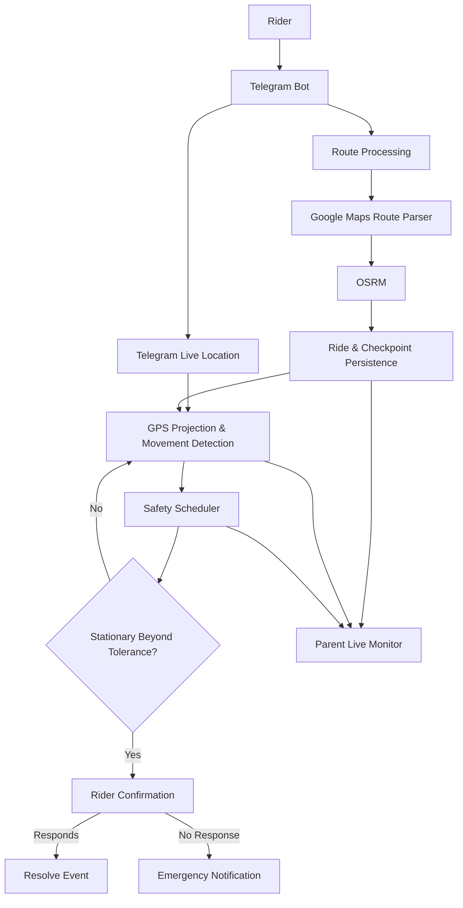

# BLIPP
### Route-Aware Rider Safety & Emergency Assistance System

**BLIPP** is a route-aware safety monitoring system designed to improve the safety of solo riders. It combines live location tracking, route checkpoints, stationary detection, and automated emergency notifications to provide guardians with better visibility into a rider's journey.

---

## Overview

Traditional location-sharing systems show where someone is, but offer limited context about their journey.

BLIPP introduces route awareness into rider monitoring. By processing a planned route, generating checkpoints, and tracking live location, the system can monitor journey progress and identify prolonged stationary behaviour that may require attention.

## Key Features

- **Route Submission:** Riders submit Google Maps route links through a Telegram bot.
- **Route Processing:** Routes are parsed and processed using OSRM.
- **Checkpoint Generation:** Checkpoints are generated along the planned route.
- **Live Location Tracking:** Telegram Live Location updates provide the rider's position.
- **Route-Aware Monitoring:** Rider progress is evaluated against the persisted route.
- **Stationary Detection:** Prolonged stationary behaviour triggers a confirmation prompt.
- **Emergency Escalation:** If the rider does not respond, an alert is sent to the configured emergency contact.
- **Live Monitor:** A browser-based interface allows guardians to view the route, rider position, checkpoints, and ride status.

## System Architecture



## Technology Stack

| Component | Technology |
|---|---|
| Backend | Java 17, Spring Boot |
| Build Tool | Maven |
| Database | H2 |
| Frontend | Thymeleaf, HTML, CSS, JavaScript |
| Mapping | Leaflet, OpenStreetMap |
| Route Processing | OSRM |
| Communication | Telegram Bot API |
| Testing | JUnit 5 |

## How It Works

1. **Registration:** The rider registers through the BLIPP web interface.
2. **Route Submission:** The rider sends a Google Maps route link to the Telegram bot.
3. **Route Processing:** BLIPP processes the route and generates persistent checkpoints.
4. **Ride Activation:** The rider starts the journey and provides Telegram Live Location.
5. **Continuous Monitoring:** The backend processes location updates and tracks route progress.
6. **Safety Assessment:** Prolonged stationary behaviour triggers a confirmation request.
7. **Emergency Escalation:** If the rider does not respond within the configured period, the emergency contact is notified.
8. **Guardian Monitoring:** The parent or guardian can observe the journey through the Live Monitor.

## Project Structure

```text
safety-net/
├── src/
│   ├── main/
│   │   ├── java/com/example/safetynet/
│   │   │   ├── controller/
│   │   │   ├── dto/
│   │   │   ├── model/
│   │   │   ├── repository/
│   │   │   └── service/
│   │   └── resources/
│   │       ├── static/
│   │       ├── templates/
│   │       └── application.properties
│   └── test/
└── pom.xml
```

## Getting Started

### Prerequisites

- Java 17 or later
- Maven
- A Telegram bot created through [@BotFather](https://t.me/BotFather)
- A configured Telegram bot token

### Installation

Clone the repository:

```bash
git clone https://github.com/arkyduky/Blipp-Tracker.git
cd Blipp-Tracker
```

Configure the Telegram bot token as an environment variable:

```bash
export TELEGRAM_BOT_TOKEN="your_bot_token"
```

Ensure the application configuration is complete, including any required rider and emergency-contact settings.

### Run the Application

```bash
mvn spring-boot:run
```

The application is configured to run locally on port `8080` by default.

Open:

```text
http://localhost:8080
```

### Run Tests

```bash
mvn clean test
```

---

## Scope & Limitations

BLIPP is an academic prototype demonstrating route-aware rider monitoring and emergency notification workflows.

- Live tracking depends on Telegram Live Location availability and network connectivity.
- Route processing depends on access to external mapping and routing services.
- Emergency notifications depend on Telegram connectivity and correct contact configuration.
- Stationary detection is based on location updates and configured movement/time thresholds.

BLIPP is not a replacement for emergency services and does not guarantee accident or incident detection.

## Future Scope

Potential improvements include:

- More robust route-link resolution and network fallback mechanisms.
- Improved location reliability and offline handling.
- Additional guardian notification channels.
- Expanded monitoring and incident history.
- Further testing under real-world riding conditions.

---

*BLIPP — Route-aware. Context-aware. Safety-focused.*
